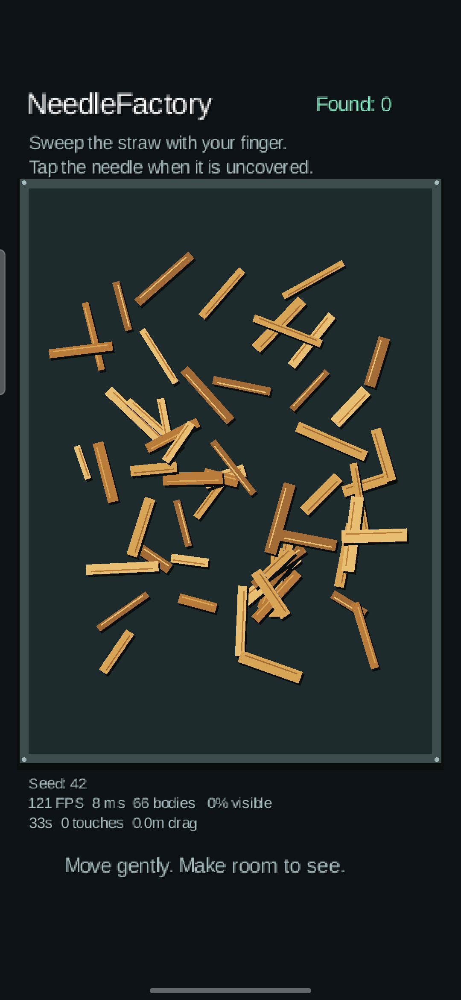
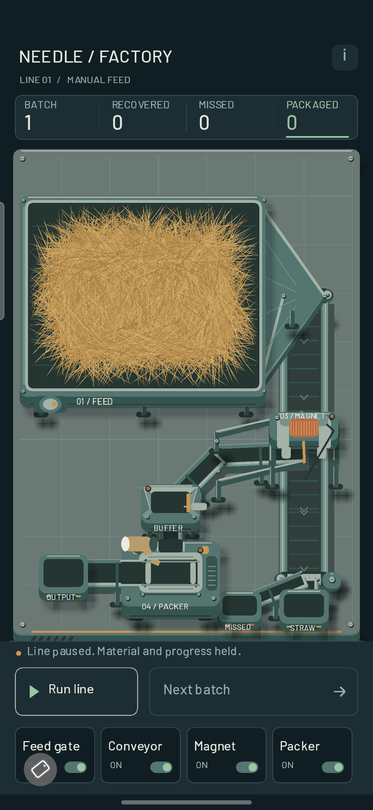
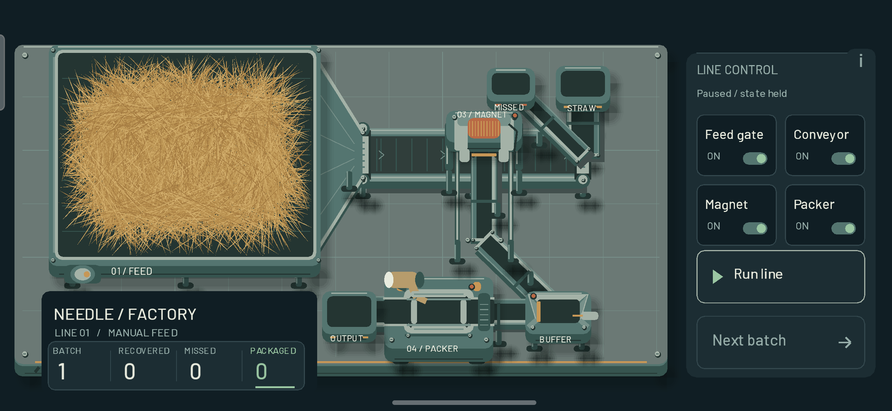

# NeedleFactory — Development History

This is the permanent record of owner-accepted milestones. Acceptance dates come
from the stage reports; checkpoints were verified against Git history. Tags identify
the accepted playable code, independently of later documentation commits.

## Current state

- Stage 0 — **ACCEPTED**
- Stage 1 — **ACCEPTED**
- Stage 2 — **ACCEPTED**
- Stage 3 — **CURRENT / AUTHORIZED — first playable slice; not accepted**

| Milestone | Accepted | Immutable tag | Accepted commit |
| --- | --- | --- | --- |
| Foundation | 2026-10-03 | [v0.0-stage0](https://github.com/sirdimitry/NeedleFactory/tree/v0.0-stage0) | [e1a6997ba207116456a489763acafdb5a3bd92cc](https://github.com/sirdimitry/NeedleFactory/commit/e1a6997ba207116456a489763acafdb5a3bd92cc) |
| Tactile Search | 2026-10-03 | [v0.1-stage1](https://github.com/sirdimitry/NeedleFactory/tree/v0.1-stage1) | [9826e184fa358b2778f7ea680adb1834b9c570b7](https://github.com/sirdimitry/NeedleFactory/commit/9826e184fa358b2778f7ea680adb1834b9c570b7) |
| First Automation Line | 2026-10-05 | [v0.2-stage2](https://github.com/sirdimitry/NeedleFactory/tree/v0.2-stage2) | [d75c779939f1ab02f7b02382e94b5ae1aef9f380](https://github.com/sirdimitry/NeedleFactory/commit/d75c779939f1ab02f7b02382e94b5ae1aef9f380) |

## Stage 0 — Foundation

**Status: ACCEPTED. Owner acceptance: 2026-10-03.**
Tag: **v0.0-stage0**. Commit: **e1a6997ba207116456a489763acafdb5a3bd92cc**.

Established the Kotlin/libGDX project with portable core, Android and LWJGL3
desktop launchers, pinned Gradle/toolchain versions, reproducible builds and CI.
The diagnostic screen validates rendering, asynchronous font loading, touch,
viewport resizing and lifecycle callbacks. No gameplay or economy was implemented.

Technical verification: two JVM tests, desktop assembly/GL smoke, Android debug
and unsigned release builds; lint had zero errors and four version warnings.
The owner physically validated launch, touch, rotation and pause/resume on
**Samsung SM-S938B**, observing approximately 120 FPS. This is a short owner
observation, not a sustained performance or thermal benchmark.

Evidence and limitations: [Stage 0 report](STAGE_0_REPORT.md).
No curated image of the final accepted Stage 0 build is retained here; historical
versions were not rebuilt or reconstructed for this history.

## Stage 1 — Tactile Search

**Status: ACCEPTED. Owner acceptance: 2026-10-03.**
Tag: **v0.1-stage1**. Commit: **9826e184fa358b2778f7ea680adb1834b9c570b7**.

Added a seeded straw-search tray with one hidden needle, bounded physical finger
pushing, fixed-step Box2D, exposure-gated discovery and blind-tap rejection.
Finding a sufficiently exposed needle increments Found once, gives visual/haptic
feedback, and enables Next pile. Portable round/session state survives
background/resume and rotation while the process remains alive.

The owner completed **10 manual rounds on Samsung SM-S938B**, checking slow/fast
drag, covered-needle blind taps, Next pile, background/resume and rotation.
Recorded implementation-time device samples were approximately **121 FPS / 8 ms**;
they do not benchmark every manual round. Automated evidence: 15 JVM tests,
debug/unsigned-release/desktop builds, zero lint errors and a ten-round GL smoke.
Stage 1 intentionally used a portrait composition fitted in landscape; Stage 2
subsequently replaced that layout with true reflow and stable module scale.

Evidence and limitations: [Stage 1 report](STAGE_1_REPORT.md).



Existing Samsung capture from 2026-10-03, copied without visual edits from
`verification/samsung-stage1-portrait.png`. This is recorded runtime evidence,
not a reconstruction. No additional historical landscape capture is published.

## Stage 2 — First Automation Line

**Status: ACCEPTED. Owner acceptance: 2026-10-05.**
Tag: **v0.2-stage2**. Commit: **d75c779939f1ab02f7b02382e94b5ae1aef9f380**.

Added the manual-feed factory prototype: the player physically pushes dense
straw into a connected conveyor → magnetic separator → buffer → packer line.
Delivered material processes automatically downstream; there is no starting
automatic feeder. Needle/package/miss routing conserves items and counts once;
Next batch requires a drained batch. Machine controls have visible consequences.

The visual/technical milestones include:

- Dense, varied, smoothly curved straw with economical patch physics.
- Thin polished-metal needle of retained length, filtered device-tilt reflection
  and no highlight at <=60% uncovered visibility; stronger late payoff above
  75% and 90%, without glow or light through straw.
- Connected 2.5D industrial machinery, supports, rollers, channels and handoffs.
- Separate portrait/landscape compositions, fixed-size gameplay/machine modules
  and flexible conveyor routing. Samsung search field: **669.60 × 535.68 px**
  in both orientations, **0% scale difference** in the instrumented comparison.
- Full-window dark Android GL surface, edge-to-edge/inset handling and retained
  active batch, machine states, counters and manual-feed state across rotation
  and background/resume.

The owner accepted the current iteration after physical **Samsung SM-S938B**
testing, including multiple complete batches, manual feeding, fullscreen without
white edges, layout/scale, lifecycle retention and needle readability. The closing
message supplied no exact physical batch count or new numeric FPS/thermal result.

Final verification: **42 JVM tests**, debug/unsigned-release/desktop builds,
**lint: 0 errors / 5 existing version warnings**, and real GL smoke over
**10 Stage 2 batches** (9 packages, 1 intentional miss, 9 haptic callbacks).
The Stage 1 regression GL smoke also passed ten rounds. Limits include shared
straw-patch motion, sampled visibility, one needle per batch, no process-death
save, no sustained thermal/weak-device study and replaceable prototype art.

Evidence and limitations: [Stage 2 report](STAGE_2_REPORT.md).
[Gameplay/economy proposal](GAMEPLAY_ECONOMY_PROPOSAL.md) remains documentation
only; no currencies, multi-needle economy, upgrades or Stage 3 runtime are included.

### Curated Samsung comparison

| Portrait | Landscape |
| --- | --- |
|  |  |

Existing full-screen Samsung captures from 2026-10-05, copied without visual
edits from `verification/samsung-stage2-scale-portrait.png` and
`verification/samsung-stage2-scale-landscape.png`. They show the **same paused
batch/seed 42**, with identical domain summary and screen-space search-field size.
These were taken on responsive candidate APK SHA-256
`6B8BF769E9FD23833C7B518DE89D8FFA1411C1F565EE7838FEDAED0C410AC686`,
before the final compact-device calibration hardening and license whitespace
normalization. Samsung module geometry is unchanged in the accepted commit;
these are pre-commit phone evidence, not newly captured images of the tagged APK.

### Playable release

[NeedleFactory v0.2 — First Automation Line](https://github.com/sirdimitry/NeedleFactory/releases/tag/v0.2-stage2)
publishes the Stage 2 checkpoint with **NeedleFactory-v0.2-stage2-debug.apk**
as a Release asset. This is a debug-signed prototype for manual testing, not a
production/store release. APK SHA-256:
`D0CD9567C06CBC3A5C6791FB5B42C7AD4AADF45B5137EAF590F3A63CC53A572A`.
The tag identifies the accepted Stage 2 code, not the later history-documentation
commit. No historical Stage 0/1 APKs were rebuilt for this task.

## Versioning policy

- Each owner-accepted Stage receives an **immutable annotated Git tag**. Never
  move/recreate a published milestone tag to include later changes.
- Significant playable milestones receive a GitHub Release.
- APKs belong in GitHub Release assets, not in the Git repository.
- Small curated screenshots may live in `docs/progress/`, with source/device
  provenance. Missing historical evidence is left missing.
- Temporary QA screenshots, recordings, logs and build outputs are not committed.
- Ordinary intermediate changes remain in commit history.
- Special playtest snapshots are created only at the owner's explicit request.
- Acceptance and saved proposals do not authorize the next Stage.

## Restore an accepted checkpoint

Use the tag to inspect GitHub source or restore code in a separate worktree:

```powershell
git fetch origin --tags
git worktree add --detach ../NeedleFactory-stage2 v0.2-stage2
```

Substitute `v0.0-stage0` or `v0.1-stage1` and a distinct directory for earlier
checkpoints. Follow the README/toolchain instructions **at that tag** to build.
This keeps the current main checkout intact; no historic checkout/build was
performed while creating this history.
## Stage 3 playtest snapshot — 2026-10-14

Owner explicitly authorized publication of v0.3.0-stage3-playtest.1 as a GitHub
prerelease with debug APK. Current Russian title: Стог и сталь / NeedleFactory.
Manual clump handling, three physical needles, paid tools/field automation,
live workshop, saved progression, sound mixer and NF identity are available.
Stage3 remains CURRENT / AUTHORIZED, not ACCEPTED / COMPLETED. Stage0–2 tags
are immutable and unchanged. See STAGE_3_REPORT.md for pass-level verification
and physical-review limitations. APK is a Release asset, never a git file.
