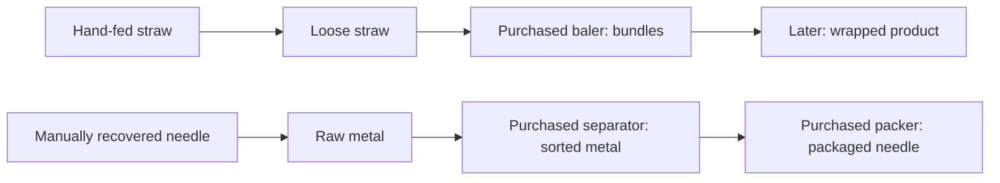

# Current owner direction: live tools and field automation

Owner authorization 2026-10-11: original cartoon work glove pinches/carries/releases;
per-instance icon upgrades with no shop sale buttons; fan double-tap saved
anchoring/feet, rotate only anchored; paid lower-right collector invisible until
owned, higher steel prices/all3 bonus; pit width +1m purchased levels; metal loss
130ms haptic/red perimeter pulse; single shop icon; caged floor fan/real air cone;
fully exposed steel cartoon glint; explicit i +100-credit playtest cheat. See
STAGE_3_REPORT.md for tuning, migration and verification. Stage3 not accepted;
no commit/push/tag/release. Existing conveyors/processing stay reference-only.

## Owner field automation / live workshop pass — 2026-10-10

CURRENT / AUTHORIZED, not accepted. Latest owner authorization replaces the
deferred automation gate: one paid robot hand, independently owned fans and
rotatable physical dividers; conveyors and processing machines deferred.
No external dependency, offline income, Stage4 editor, commit/push/tag/release.
Toolkit: GAMEPLAY_CORE + ECONOMY_PROGRESSION + PHYSICS_TOUCH + GAME_FEEL +
UI_UX + QA_VERIFY + ANDROID_PLATFORM + VISUAL_ART + PERFORMANCE.

Symptom: upgrades waited for another lot / paid material could be repriced ->
cause: material manifest snapshots -> fix: value/luck update immediately for
unpaid objects; paid identities retain their exact historical payout. Quantity
adds new straw identities to ACTIVE batch, preserves existing poses/routes,
renumbers independent steel while preserving its gameplay state, then rebuilds
only the native adapter. Closed/draining batch is never reopened; purchased
quantity is available in the next lot. Verification: live repricing, growth,
conservation, save and no-double-settlement regression tests.

Symptom: shop was selectors/pages and purchases had no confirmation -> cause:
fixed three-card composition -> fix: one independently expandable vertical
document, clipped scrolling, bold section hierarchy, persistent wallet; each
paid transaction requires explicit Да / Нет. No cancels debit and failed
transactions keep an explanatory panel. Owned tool selection is free and does
not need a purchase dialog. Simulation pauses behind workshop/confirmation.

Symptom: automation had only a locked placeholder -> fix: explicit bought
world objects with IDs, positions, degrees, speed/width/range and invested cost.
Content save7, schema3; old content6 loads with empty equipment, unchanged
wallet/receipts/tools. Positions are authoritative world coordinates independent
of orientation. Local Box2D barriers and paid airflow are separate from rendering.
One robot travels to a real clump and carries it to the pit; steel can accompany
contacted straw, is still missable, and never sorted for free. Robot does not
create output by remote reward calls. Fans only apply force inside their cone;
heavy steel responds less. Removing equipment removes force/joints/colliders.
No purchased automation = prior manual-only/no-idle-feed baseline.

Tuning: robot200; speed upgrades300/450/675/1012 then2025 (after level5,
doubling). Fan500; each axis upgrades750/1000/1250/1500 then3000, doubling
after level5. Fan width18/26/34/42/50/58/66/74/82/90 degrees (ten versions).
Range3m, +0.45m per bought range tier; force28 +3 per speed tier. Physical
force and robot transit speed have safety ceilings; high-level/endgame tuning
is not balanced yet. One robot only; multiple fans/dividers, each independently
saved. Divider40 (initial tuning), length1.3m, central pivot, quantized1°.
Paid field object sale returns50% invested credits; original starter pile/pit
are permanent, not purchased objects. Bought needle receiver can also be sold.
Previously recovered steel remains payable even if its receiver is sold.

Interaction: tap selects, short drag moves selected object. Second press held
300ms without dragging enters local pivot rotation; direct angular response,
1° quantization, centre dead zone avoids angle jumps. Release saves. Rotation
ring/degrees appear only on selected object; sale and hide buttons remain local.
No free grid, conveyor routing or machine placement framework.

Field: pit world extends12.4 ×22.2m (y=-12.7..9.5) and keeps24.8 canvas units/m.
Portrait bottom console shortened; yard fills more of available floor width and
height. Landscape uses invertible rigid rotation; no individual needle scaling.
Small perimeter and existing Samsung Edge touch inset stay intact.

Verification: 149 JVM tests; debug/release/lint and native GL pass; Samsung
confirmed purchases, live material changes, fixture rotation, robotic carry,
fan influence/resale, save/restart and lifecycle. See STAGE_3_REPORT.md for
measured evidence, funded private QA scope and remaining owner decisions.
Known limits: no offline/rare/processing line; current physical lot is not
persisted through true process death; robot has simple direct routing and may
need a divider moved if blocked; many-fan endgame requires later profiling;
1000 saveable numeric tiers, 360 live clumps and safe motion caps are prototype
technical limits, not a claim of infinite simulated endgame.

# Stage 3 — Economy & Progression design

## Owner clump progression v6 — 2026-10-10 (current bounded candidate)

Supersedes v5 straw-volume tuning. The basic lot has24 physical clumps, each
accepted/ground clump pays1 immediately; full straw delivery adds6. Needles
remain6 at bought receiver18, zero in screw pit. All-material/3-steel revenue48;
straw-only revenue30. Two full straw lots60 fund a meaningful choice:

| Purchase | Initial price | Change |
|---|---:|---|
| Three-tooth manual loosener |50| Two nearby clumps, hand spring response1.2x |
| Material value |55| Next lot:1 ->2 per clump, then3,4... |
| Extra material |45| Next lot:+1, then+2, then+3... |
| Loosener grip level |35| +1 nearby clump each level |
| Loosener speed level |30| +0.12x response each level |
| Ordinary manual rake |200| Loosener grip+5, response+five0.12x steps |
| Rake grip / speed |100 /90| Additional +1 /+0.12x independently |
| Better material chance |120| Next lot:+2 percentage points for x2 value |
| Screw speed |40| +15% grinding rate per level |
| Screw quantity |55| +1 concurrent grinding slot per level |

Each repeatable price is floor(base *1.75^ownedLevel), including levels1–5
and beyond. Five is not a hard level cap. Prices stay in economy definitions.
Ordinary rake inherits current loosener improvements, so its five-step advantage
survives later loosener purchases. Speed is spring response, not remote force,
automatic pickup or idle feed. A wider head can grip only nearby stalks actually
under it at touch-down; rated capacity is a maximum, not a guaranteed remote
selection. Steel retains its accepted heavier physical grab response.

Always-accessible Upgrades accordion: Tools, Materials (value/count/chance),
Receiver, Automation. Portrait vertical categories, landscape side categories;
three compact purchase rows with page navigation. Opening pauses simulation
and releases touch; closing preserves batch. Purchases use real earned wallet.
Material price/count/chance are captured for the next lot, never reprice a
partially delivered lot. Tools and screw changes apply immediately.

Per-clump paid IDs/amounts are durable. Already paid clumps restore as delivered,
not physical positions; final settlement pays only remaining metal/bonus.
Receipt still reports total batch revenue. Rare valuable straw is seeded by
lot/id, not a rerolled random payout on save/quote. No premium currency.

Prototype technical ceilings:360 physical clumps, local reach2.5m, spring
frequency20Hz, luck25%; costs saturate at10^12 and save levels validate0..1000.
These guardrails are not a claim of balanced infinite progression or10-hour
content. Long-run balance, higher-tier receiver/machine silhouettes and full
factory construction require separate passes. Automation remains a future
paid-line category, no actual feeder/conveyor construction in this pass.

Screw admission: release commits only clumps already carried over the physical
hole. Material waiting in the local queue is ground in turn, then paid. Cheap
short straw fragments replace whole-clump shrink rendering; no new shader/body
for each fragment. No suction from the floor after touch ends.

Historical 2026-10-10 owner feedback: after buying the needle receiver, metal income
dwarfs straw. New design-only candidate and procedural belt/station direction:
[Straw economy / procedural line proposal](STRAW_ECONOMY_CONVEYOR_PROPOSAL.md).
V5 values are for owner review, not current runtime tuning. Earlier prices and
history below remain unchanged until an approved bounded implementation.

Latest owner drawing (2026-10-08): starter auger pit occupies the far lower-left
corner of the portrait floor, not the edge of the search table. Real manual
carry extends across the yard. Landscape rotates the yard at the same object
scale. Pit is deep and dangerous, with sparse idle sparks, stronger straw
impact and a pronounced steel impact. Steel dropped here is missed and earns
zero; buy the nearby independent receiver to sell manually delivered needles.
Conveyor tiles, splitter, branches/spill handling and machine construction
remain later bounded implementation passes, not complete in this candidate.

## Manual-to-Factory Progression v4 — owner direction 2026-10-08

Supersedes the long receiver and free raw-metal tray in the current starter.
The reference line and historical designs below remain available; do not delete
working systems or silently remove bought IDs from saves.

### Playable starter now

Upper-left source bin with a thick top-view straw pile -> physically pull one
clump out -> carry it across empty floor -> small square recessed auger pit in
opposite lower-right corner. The open front of the source bin has no invisible
trapping wall. The pit rotates, has real helical plate flights, dark depth,
hazard stripes and restrained amber sparks. No global suction; only LIVE local
hand delivery into its own aperture admits an object. Material left on the floor
stays there. The former full right edge is not an intake anymore.

Dense material uses approximately four times the rendered stalks but retains
24 portable groups (3–5 important stems plus associated decorative layers).
All visual stalks contribute to real occlusion and move with their group;
only important stems own collision fixtures. No extra independently simulated
strands are needed to get a thick heap. Three needles remain separate seeded
heavy objects with accepted size/metal/exposure thresholds.

Before a metal receiver is bought, needles carried into the common pit are
missed, worth ZERO. No free lower tray and no tap recovery. The first separate
receiver is bought and physically installed at an authored pad beside the pit;
only a manually carried exposed needle into this port becomes saleable metal.
Straw is rejected by that sorting port and remains hand-movable on the floor.

### First tuning and example pacing (not a ten-hour balance claim)

| Purchase / product | Credits | Manual task / value change | Visible result |
|---|---:|---|---|
| Full admitted loose-straw lot | 6 | Pay only accepted product; no metal pay in pit | Straw disappears into dangerous floor screw |
| Needle receiver | 18 | Unlocks separate raw-metal sales; does not find/carry needles | Small separate tray next to pit |
| Raw needle into bought receiver | 24 each | Finding AND carrying metal is now more valuable than loose straw | Needle retained in paid tray |
| Rake | 150 | Carry up to two nearby groups, still all manual | Bought hand-tool head |
| Steel rake | 450, requires Rake | Up to three local groups, no released traction | Different hand-tool head |

First receiver takes about three full starter straw lots (18/6). This is the
first meaningful growth, before demanding large machine prices. Afterward,
1/2/3 recovered needles plus full straw pay 30/54/78; Rake takes about 2–5 such
lots, depending on search/recovery skill. First party target remains 45–90s of
active work, not QA pauses or instrumentation waits. Exact timing and the
3–4x pile's feel must be decided through owner touch tests. Early finish keeps
only admitted straw/recovered metal; uncollected heap gets no money or fake
penalty. Rewards settle once, with conserved quantity and durable receipt.

### Future purchased factory, after this starter review

1. Buy/place conveyor sections from pile toward pit; reduce carrying distance.
2. Buy processing stations mounted onto valid belt segments, increasing product
   value or removing a concrete manual obligation. None appears for free.
3. Buy a splitter before opening a second belt branch. It divides actual cargo;
   conservation forbids copying one object to both outputs.
4. Buy magnetic separator and metal-branch transport plus its receiver.
   Unowned/missing downstream endpoints must spill cargo onto accessible floor,
   not teleport it into an invisible buyer. Spilled items are re-grabbable and
   not paid twice. Reconcile which branch carries straw vs metal before UI/build
   implementation: owner's description mentions straw falling with no metal
   receiver; recommendation is explicit product-specific endpoint routing.
5. Add baling/wrapping/drying and later assisted/full automatic feed only after
   paid machinery, valid connections and clear progression demand.

Preset installation is sufficient now. Tile construction, placement, routing,
rotation and Build Mode belong to a separate approved implementation pass / next
version; this sub-pass does not implement a grid editor, branch simulation or
new downstream machinery. One currency remains Workshop Credits. Rare/golden
finds, offline income and 10+ hour endgame need their own content/balance design;
they do not fix a weak basic manual-product loop by themselves.

### Owner review questions

Is the distant square pit correctly sized/located? Is the four-layer source
heap pleasant to extract rather than tedious? Does 6/full lot and an 18-credit
receiver feel fair? Is 24/needle sufficiently motivating without dwarfing the
straw stream? Which precise output should spill when a future branch has no
receiver? Answer before expanding construction/automation beyond this starter.

## Current bounded archive adaptation — 2026-10-08

Owner supplied a playable source prototype and authorized adaptation with our
graphics; machine construction is next version. Current trial is documented in
[archive adaptation](ARCHIVE_REFERENCE_ADAPTATION.md): Hand/Rake/Steel1/2/3 local
grips, normalized products-v3 values/prices, preserved owned preset equipment,
schema3 migration and late exposed-needle star. V1/v2/v3 design history below is
retained; older runtime prices are historical, not current economy tuning.
The ten-hour progression target still requires future jobs/endgame/balance work.

Status: **CURRENT / AUTHORIZED; NOT ACCEPTED**. Updated 2026-10-05 following
physical owner feedback. Owner subsequently authorized one small product-value
sub-pass: manual receivers, loose/raw sales and a purchased Baler. These first
capabilities and trial prices are now implemented, pending Samsung owner review.
The rest of the ladder below remains a proposal, not authorization to expand.

## New owner direction — 2026-10-06, design v3 under review

See [clump/grip/factory-growth proposal v3](STAGE_3_PROGRESSION_V3_PROPOSAL.md).
Owner proposes 3–5-straw clumps, ten mirrored templates, direct single-clump
dragging, five grip/receiver levels, bought conveyor sections, visible machine
levels, a rare five-value golden needle and 10+ hours of overall progression.
The note explains current pusher physics, revises pacing and separates Stage 3
preset purchases from Stage 4 tile placement. Owner now authorized the bounded
tactile prototype: ten small clump families, 24-clump trial and direct one-clump
grab. Products-v2 prices/accounting remain; no paid tiers, grid or rare items.
The v2 historical candidate/design below are retained for provenance.
The old 30–40-minute auto-feeder timing is not the proposed 10-hour-model target.
Stage 3 remains not accepted, with no commit/push.

Owner corrective authorization 2026-10-06: preserve difficult manual straw feed,
replace pinched radial clumps with acute staggered crossings, and remove instant
tap recovery from the grab preset. Needle acquisition becomes a physical grip;
manual delivery to the metal port earns raw value. Buried steel can be entrained
locally and missed through the common straw receiver. All machines/conveyors/
upgrades are paid purchases. No free conveyor or magnet in the starter preset;
the current gravity receiver transfer is not automation. Purchased shared belts
and separator remain a later authorized progression sub-pass.

The original first-slice design is preserved in [STAGE_3_DESIGN_V1.md](STAGE_3_DESIGN_V1.md).
The progression preset now uses rake 28, optional guides 16, Baler 42, loose/bundled
straw 6/16 per full lot and raw metal 3 per secured needle. The original complete
line/economy remains a reference preset. Existing earned wallet balances, tools
and settled receipts survive migration without being repriced.

## Paid transport/separator boundary — 2026-10-06

Owner authorized conveyor then magnet after accepting physical clumps/steel.
Two preset purchases only: Short Conveyor **48** after Baler; Magnetic Separator
**72** after conveyor. Trial prices reuse v2, not the proposed ten-hour tier curve.
Hand loading reaches x=7.4 instead of x=10 in the unchanged 10x8 search module;
local contact is still required. Paid lane x=8.55 carries material to discharge
at y=0.6. Magnet acts only on steel reaching that discharge; off/unowned means
missed metal. Sorted needle **4**, raw manual **3**, straw **6/16**, no additive
raw+sorted reward. Purchase changes geometry/behavior, settlement stays once.
This is a preset assembly, not one paid tile, free placement or an auto feeder.
Schema 2 adds optional receipt.sorted (old default 0), old paid receipts keep
original value. Existing wallet/purchases remain. All other progression remains
proposal; stop for owner review without commit/push.

## 1. Core loop — Manual-to-Factory Progression v2

Work by hand → expose/recover metal and push straw into a receiver → sell actual
products → keep earnings or continue this batch → buy a useful tool/processing
machine → see it appear → produce a better product or remove a manual task.

The player buys the production process, not percentage multipliers. Initial
equipment is a search table, a simple straw receiver and a manual metal collection
tray. No baler, conveyor, separator, buffer, packer or feeder is granted for free.
The accepted Stage 2 complete line remains a technological reference/QA preset;
it must not be deleted or presented as the progression player's starting property.

Two product branches share one wallet, **Workshop Credits / Кредиты мастерской**:

## 2. Multi-needle model and fair search

Keep exactly three seeded authoritative needles in ordinary early batches.
Each has a stable ID, route, recovery state and sale state. A perfect recovery is
3/3; a perfect batch also sells the whole usable straw lot. Missing a needle
forgoes its value, never deletes another needle's secured earnings. An unfinished
batch can be cashed out; no obligation to spend minutes hunting the last object.
Display found/secured 0/3, not directional hints or exact hidden positions.
Later challenge contracts may have 1–2 valuable needles; variable counts and
contracts are not part of the next sub-pass.

Manual metal recovery should reuse the Stage 1 exposed-object interaction rules:
no blind tap through cover, a deliberate local pickup/transfer into the metal tray.
Pickup is a gameplay visibility decision, not a render shader decision. Details
of the short transfer gesture need a device prototype before finalizing.
Purchased separator later removes part of that search/transfer duty. Existing
magnet/buffer/packer state machines continue tracking individual IDs.

Preserve accepted needle length/thickness, polished steel and tilt-dependent
highlight: <=60% visible OFF, above 60% gradual sheen, stronger late payoff,
covered segments occluded. Dense, varied straw remains interesting. Shorter
batches should come from achievable workloads/receiver access, not revealing the
needle at spawn, reducing all density, or covert feed assistance.

## 3. Early finish: sell what was earned

For v2, recommend Finish after the first verified sale, including straw-only
work. Replace the first-slice requirement of one recovered needle +25% material
with this product-based rule. Already secured value is never reduced.

Compact preview: **Keep 8 credits · End this batch** and secondary text stating
that remaining straw/finds will be left behind. Continue stays available. On
confirmation, stop new intake and settle already accepted work safely. Finished
products sell; a bounded drain completes committed processing where possible.
Unfinished product that cannot reach a valid sale route adds no new value. No
percentage penalty, time penalty, forfeiture of sold goods or aggressive dialog.

No artificial perfect-clear cash grant: completing the work naturally sells more
straw and more needles. Perfect Clear remains a satisfying visual acknowledgement.
Early finish is attractive when the last find costs more effort than the player
wants to spend, not because short runs have a payout multiplier.

## 4. Currency and transparent product reward

One main currency: Workshop Credits. Rare collectibles are not required to repair
the baseline economy. Recommended initial **proposal**, prices per full normalized
straw lot or one needle:

| Product | Sale value | What creates the value |
|---|---:|---|
| Loose straw | 6 / full lot | Manual collection |
| Bundled straw | 16 / same full lot | Baler physically compresses/binds it |
| Wrapped bundle, later | 24 / same lot | Future wrapping stage |
| Raw recovered needle | 3 each | Manual recovery |
| Sorted / inspected needle | 4 each | Separator's defined sorting route |
| Packaged needle | 7 each | Packer finishes the product |

These are final prices, **not additive payouts** for each transformation.
Packaged needle sells for 7 total, not 3+4+7. Straw mass is conserved; splitting
patches must not create more saleable material or rounding benefits.

`Earned = floor(sum(sold straw mass × actual grade price)) + sum(sold needle prices)`

Round the aggregate straw subtotal once; carry fractions internally, never round
each decorative strand. Product grade is set by real processing, not merely by
owning a machine or pressing its toggle. Selling raw material removes it from the
processable inventory. Purchasing a machine cannot retroactively upgrade sold goods.
No time, streak, skill multiplier, quadratic completion bonus or offline award in
this revision. Display straw and metal subtotals, then total. Batch settlement
and any live secured-value ledger must credit each sale exactly once.

## 5. Numerical examples

| Outcome | Straw | Metal | Earned |
|---|---:|---:|---:|
| Poor: 50% loose, no needle | floor(6×.50)=3 | 0 | 3 |
| Early: 25% loose, one raw | floor(6×.25)=1 | 3 | 4 |
| Normal: 80% loose, two raw | 4 | 6 | 10 |
| Perfect manual: full loose, three raw | 6 | 9 | 15 |
| Normal baler: 80% bundled, two raw | 12 | 6 | 18 |
| Perfect baler: full bundled, three raw | 16 | 9 | 25 |
| Normal packaged: 80% bundled, two packaged | 12 | 14 | 26 |
| Perfect full purchased route | 16 | 21 | 37 |

Mixed grades: 40% bundled +20% loose gives floor(6.4+1.2)=7 straw credits;
one raw and one packaged needle add 10. A missed third needle adds zero. A
challenge lot may later price selected needles higher, but needs a declared
contract; no hidden difficulty multiplier is necessary now.

## 6. Upgrade ladder and first purchases

Recommended order: **rake → optional guides → baler → short conveyor → separator
→ buffer → needle packer → assisted feeder → automatic feeder**.
Baler precedes the conveyor/magnet because an early purchase should change what
the player sells, while preserving manual search. Guides are an optional comfort
choice, not a mandatory toll before the first processing machine. A conveyor
then solves carrying bundles between real nodes; it is not an auto-intake tool.

| Machine/tool | Purchase price | Prerequisite | Manual task removed / eased | Product value added | Expected unlock time | Visual factory change |
|---|---:|---|---|---|---|---|
| Table + two manual receivers | Free | Start | None | Loose 6; raw needle 3 | Immediately | Open working area, simple trays |
| Feed Rake | 28 | First completed sale | Wider local hand strokes; no persistent force | None | 2–3 batches, ~2.5–4 min | Hand tool with readable head/handle |
| Feed Guides / Funnel | 16 | Rake; optional for baler | Less spilling near receiver; player still pushes | None | ~4–5 min | Bolted cheeks on receiver |
| Straw Baler / Bundler | 42 | Rake | Compress/bind task; feed remains manual; current candidate ejects to its local tray | Straw 6→16 / lot | ~7–9.5 min | Jaw, binding spool, drive and output tray |
| Short Conveyor | 48 | Baler | Carrying product between two mounted nodes | None directly | ~11–13 min | Connected belt, rails, drums and supports |
| Magnetic Separator | 72 | Baler + conveyor | Part of metal pickup/sorting; intake remains manual | Needle 3→4 | ~14–17 min | Gantry plus metal discharge chute |
| Buffer | 56 | Separator; demonstrated backpressure | Repeated unload/stop juggling | None directly | ~17–20 min | Finite bin/funnel and gate |
| Needle Packer | 110 | Separator; buffer recommended | Manual packing/handling | Needle 4→7 | ~20–24 min | Packing jaw/spool and finished-product tray |
| Assisted Feeder | 135 | Baler + conveyor | A contacted feed stroke becomes easier, not autonomous | None | ~24–28 min | Contact-driven roller/rake arm |
| Automatic Feeder | 320 | Assisted + separator + packer + three stable assisted batches | Manual feed of the currently loaded batch | None directly | ~30–40 min | Hopper, visible drive and Auto/Pause control |
| Wrapper, later | 160 provisional | Baler + conveyor | Manual wrapping | Straw 16→24 | Later stage | Wrap roll and exit frame |

Times after minute 15 are hypotheses, not simulated/playtested guarantees. Every
paid milestone removes a felt duty or creates a named better product. Numeric
speed tuning is a secondary later layer. Automatic feed must be an explicit
owned machine state, never a stronger rake force. It does not select Next batch,
reroll seeds or generate offline income by itself.

## 7. Concrete first 10–15 minutes model

Assumptions: first active batch 75 seconds, subsequent manual batches 60; 55
after baler, 45 after conveyor because an actual handling duty disappears. Add
5 seconds results and another 5 seconds per purchase. Sell 80% straw and alternate
2 then 3 recovered needles. No rare finds, perfect bonus or idle money.
Raw mean income = 11.5; bundled mean = 19.5. Actual player times and recovery must
be measured; the model does not demonstrate that those speeds are already usable.

| Batch | Elapsed minutes | Income | Purchase | Wallet afterward | Player physically gains |
|---:|---:|---:|---|---:|---|
| 1 | 1.33 | 10 | — | 10 | First immediate earnings |
| 2 | 2.42 | 13 | — | 23 | Almost enough for first tool |
| 3 | 3.58 | 10 | Rake 28 | 5 | Wider manual tool |
| 4 | 4.75 | 13 | Guides 16 | 2 | Receiver cheeks |
| 5–7 | 8.00 | 33 combined | — | 35 | Saving for real processing |
| 8 | 9.17 | 13 | Baler 42 | 6 | First higher-value product |
| 9 | 10.17 | 18 | — | 24 | Bundled product income |
| 10 | 11.17 | 21 | — | 45 | Conveyor nearly affordable |
| 11 | 12.25 | 18 | Conveyor 48 | 15 | No hand carrying between nodes |
| 12–13 | 13.92 | 39 combined | — | 54 | Saving for separator |
| 14 | 14.83 | 21 | Separator 72 | 3 | Automatic separation/sorted metal |

After separator, 80% bundled +three sorted needles earns 24. Two earns 20.
Skipping optional guides brings baler to about minute 7 in this model. Consistently
recovering only two needles with 75% straw gives roughly 10 per raw batch, rake at
batch 3, guides at 5, baler at 9 (~10 minutes). That slower case needs playtest:
if most beginners exceed ten minutes before processing, reduce workload/price
or revisit the ordering rather than introducing hidden automation.

The deterministic arithmetic oracle is `verification/stage3_progression_v2_model.py`
(QA artifact, not gameplay implementation). It asserts purchases at batches
3/4/8/11/14 and the first baler within ten minutes under the stated assumptions.
This is a pacing hypothesis, not an economy acceptance result.

## 8. Batch structure and difficulty

Keep Next batch as a simple seeded work order; three needles and one normalized
lot, no contract-selection screen yet. Definition fields can later add product
requirements, grade values and a different needle count. Difficulty grows through
placement/overlap, pile shape and processing constraints, not arbitrary HP.
Challenge needles, contaminants, look-alikes and time contracts are later content.

Target first active batch 45–90 seconds, ordinary early batches roughly 60–90.
Do not assume a repetitive QA drain is representative of play. Measure meaningful
strokes, time to first sale, time to one/all needles, and total batch duration.
Mixed 2/3 success should advance ownership without requiring every batch perfect.
The current 320 interactive patches need not become the starter workload. A future
prototype can trial roughly 80–140 meaningful patches while maintaining dense,
varied cheap visual coverage and fair needle occlusion; normalize total saleable
mass independently of patch count. Validate that larger represented patches do
not look like brushes/ropes or clear an entire hidden region in one stroke. This
is implemented as a 120-patch tuning experiment in the authorized Baler candidate;
owner review must still judge tactile density and duration.

## 9. Factory growth and UI

Use authored mounting slots, keeping accepted world/module scale across rotation.
At start show working area and modest unused workshop floor. Reveal only the next
useful mounting pad/blueprint, not ten noisy ghost machines. Bought units appear
physically with connections and functional input/output. Unowned machines have no
colliders, toggles, passive ability or invisible downstream service.

Rake/guides make early purchases visible; baler within 5–10 minutes delivers the
first unmistakable machine. Baler+conveyor+separator by roughly 15 minutes should
read as a small purchased factory. Machines grow into real ports/pads; conveyors
adapt geometry rather than scaling the whole scene. No free placement/build grid.

During search: wallet, secured +X, needles 0/3, compact material indicator and
Finish/Workshop. Results: Straw product, Metal product, Total earned, wallet,
Perfect indication if appropriate; Next / Workshop. Expand details only on demand.
Workshop describes the new duty removed/product made, price and prerequisite;
it must not sell unexplained percentages. Visual state labels supplement color.

## 10. Rare finds and rare currency

Retain brass medallions and later gold/platinum collectibles as a beautiful optional
jackpot layer; not part of baseline budgets or mandatory machine progression.
No new drop rates or rare wallet implementation in this pass. Historical rarity
ideas remain in V1 and GAMEPLAY_ECONOMY_PROPOSAL. Later findings must be seeded,
physically reachable and individually conserved; cashing out can leave them behind.
Collector currency may buy cosmetic themes/unusual optional modules, never simply
substitute for Workshop Credits or require real money.

## 11. Save and architecture proposal

Reuse portable FactorySession, seeded items, existing world-unit mounting/port
descriptions and pipeline machines. Add owned capabilities separately from the
enabled switches; product grade/mass and ledger are authoritative gameplay/economy
data, never renderer truth. No new runtime framework or dependency needed.

Future save revision: schemaVersion, contentVersion/economyModelId, profileKind,
WorkshopCredits, owned tool/machine IDs, unlocks, nextSeed, settled receipts and
secured product ledger/manifest. Reserve a layout section for later position/
rotation, but do not implement Build Mode. No per-straw physical poses/render data.
Validate versions/defaults, retain unknown stable IDs, atomic replace + backup.

Existing first-slice saves cannot silently become a new empty factory or have
their earnings repriced. Use an explicit **separate QA playtest profile** for
physical automation. The current schema-2 implementation migrates both normal
and QA schema-1 files in place, preserving wallets, tools and paid receipts.
Restart after a live sale must never regenerate its sellable item: store settled
IDs/mass or close that paid batch before physical reset. Current runtime has no
live wallet sales: preview earned value, then settle once and persist the receipt.
It therefore needs no live paid-inventory ledger in this sub-pass.

## 12. Offline recommendation

**Offline income = 0.** Even buying an automatic feeder in a later sub-pass does
not authorize offline production. A later owner-reviewed model may simulate only
owned automated capacity with capped supply/output; no hidden needles recovered
or unrestricted passive currency. Physical searching remains worthwhile.

## 13. Anti-frustration / abuse oracles

- Rake force is local to live tool contact; release removes feed permission and
  motion settles. No global attraction, no mass handoff from a permanent touched flag.
- Validate seeded reachability, exposure and receiver access; never require an
  inaccessible buried needle for advancing the basic loop.
- Finish permits secured straw-only value; avoid stuck batches and last-key grind.
- Missed needle loses only its prospective value. UI must distinguish zero missed
  early finish from actual loss; do not blame an already enabled magnet.
- Stable sale IDs, conserved mass and single settlement prevent duplicate rewards
  through rotation, resume, restart, Next, repeated clicks or machine purchase.
- Failed processing cannot mint a higher grade; no product sold twice in two grades.
- Benchmark short-run farming: one raw needle in five seconds would yield 36/min,
  above the projected manual 11–12/min and would be unacceptable. Aim for first
  meaningful sale in 15–30 seconds with natural material work; early 3–5 credits
  must not systematically out-earn careful runs. Verify across seeds/player skill.
  This needs a real tactile prototype, not a claim based solely on the income table.
- Rare luck protection is deferred with rare content; no forced rare drops are
  required to afford mandatory baseline machines.

## 14. Scope / next implementation step

**Authorized current sub-pass:** keep the accepted rake/contact fix; manual
receivers, actual loose/raw product accounting, one bought Baler producing bundles,
save migration/results/Workshop and regression/device verification. No other
machine purchases, feeder, rare finds, offline income or Build Mode. Stop for review.

**Implemented current candidate, not accepted:** empty progression preset;
manual straw/metal receivers; three fair needle pickups; loose/raw sales ledger;
rake and optional guides; one purchased baler producing bundles; saves/results
and compact Workshop matching those capabilities. Reuse accepted line as QA
reference. Stop when first paid processing demonstrably changes product value.

Current implementation uses 120 interactive straw patches and 32 independent
curved strands per patch (3,840 visual strands). Accepted field scale and needle
size stay unchanged; workload, not camera zoom, is reduced. Product quantities
are normalized accepted patch units. A 12-unit chamber cycle takes 1.1 seconds;
partial loads also flush, so there is no permanently trapped small batch.
Only terminal loose/bundled material is saleable; a pending chamber cannot mint
the higher price. Early finish drains only already accepted processing work.
No live wallet sales are made: secured value is previewed, then settled once.
Process death may restart the unpaid physical lot; paid receipts block replay.
Schema 2 retains schema-1 credits/tools/receipt and adds product grade/model fields.
Debug physical QA has its own profile; normal owner progression is preserved.

**Should have if cheap in that sub-pass:** one next-machine mounting preview,
subtle mechanical purchase/recovery feedback, useful product icons/labels.

**Later Stage 3 sub-passes:** purchased conveyor, separator, buffer, packer, contact
assist and eventually explicit automatic feeder, each validated independently.
**Later stages:** wrapped product, rare content/economy, contracts, complex quality,
offline, Build Mode, free conveyor editor, prestige. No monetization.

## 15. Owner review of current candidate / later decisions

1. Does the authorized Baler-before-conveyor order feel like visible factory growth?
2. Review implemented trial loose/bundled 6/16, raw 3 and tool/Baler prices
   28/16/42 on device. Sorted/packaged 4/7 and future 48/72 prices remain proposals.
3. Review Finish after the first saleable credit, including straw-only work,
   with no artificial early penalty or perfect cash grant.
4. Review schema-2 migration keeping existing wallet/tools/receipts; fresh-start
   pacing needs a new profile, not resetting the owner's earned balance.
5. Review the small bound bundle over a large bale for the first Baler. Recommended:
   bundle, legible at accepted module scale and quick to move by hand.

## 16. Preserved and changed sources

Preserved from V1 / GAMEPLAY_ECONOMY_PROPOSAL: three ordinary needles, fair hidden
search, one main wallet, secured reward kept, deterministic identity, versioned
save, meaningful automation, attractive rare collectibles later, no early offline.
Changed by owner feedback: no free complete factory; machines purchased visibly;
two product value branches; baler is early processing; shorter work cadence;
prices modeled from product income; no quadratic material reward or arbitrary
perfect cash grant; early finish product-based rather than 25% +needle gate.
V1 is archived for provenance, not a conflicting instruction to implement it all.
