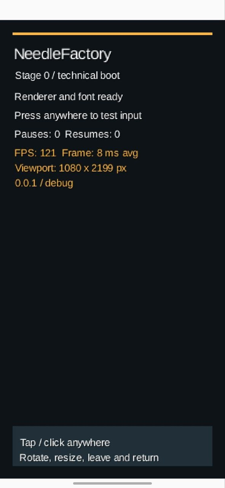
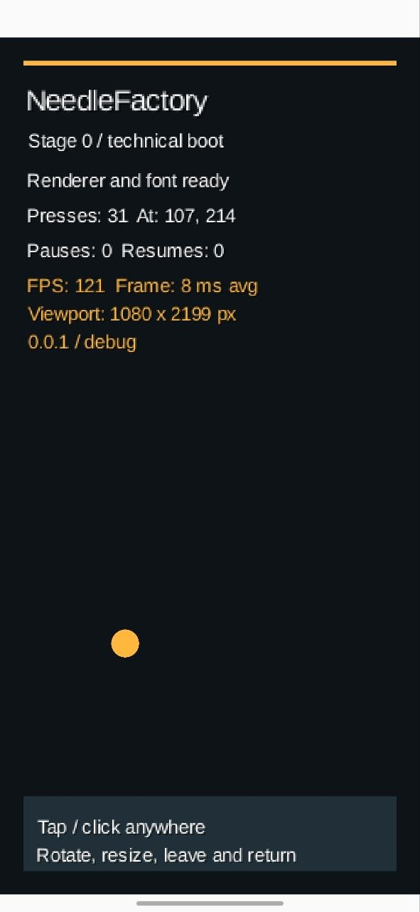

# 001 — Технический запуск Stage 0 / Stage 0 Technical Boot

## Русский

*3 октября 2026 года, 19:08 — начало моей NeedleFactory.*

**Статус:** первые два скриншота, техническая проверка Stage 0.

С этих двух экранов началась моя NeedleFactory. Иголки и соломы ещё нет, зато шрифт уже вышел на площадку. На первом снимке приложение предлагает проверить касания; на втором счётчик показывает **31 нажатие**, а в кадре появилась жёлтая точка. Для первого дубля — вполне себе действие.

### Что видно на экране

- **NeedleFactory — Stage 0 / technical boot**
- **Renderer and font ready** — сообщение о готовности рендера и шрифта.
- **Press anywhere to test input** — предложение проверить касания на первом снимке.
- **Presses: 31; At: 107, 214** и жёлтая точка — состояние ввода на втором снимке.
- **Pauses: 0; Resumes: 0** — счётчики пауз и возобновлений.
- **FPS: 121; Frame: 8 ms avg** — показания на момент снимка, не результат длительного бенчмарка.
- **Viewport: 1080 × 2199 px** — значение, отображённое приложением.
- **0.0.1 / debug** — подпись версии и режима.
- Внизу: **Tap / click anywhere** и **Rotate, resize, leave and return** — подсказки к техническим тестам.
- На экране видны светлые полосы сверху и снизу; это наблюдение по изображению, без установленной причины.

### Маленькая победа

Моё приложение запустилось, показало текст и начало считать нажатия. До иголки в стоге сена ещё далеко, но хотя бы телефон уже понимает, что я к нему обращаюсь.

**Следующая запись:** [002 — Ранний игровой прототип](002-early-gameplay-prototype.md).

### Скриншоты

<figure class="screenshot portrait"><figcaption>С этого всё началось: игры ещё нет, зато Renderer and font ready. Шрифт вышел на площадку первым.</figcaption></figure>
<figure class="screenshot portrait"><figcaption>Уже 31 нажатие и жёлтая точка в кадре. Мой первый интерактивный спецэффект — пока без иголки.</figcaption></figure>

---

## English

*October 3, 2026, 7:08 PM — the beginning of my NeedleFactory.*

**Status:** first two screenshots, Stage 0 technical boot.

My NeedleFactory started with these two screens. No needle or straw yet, but the font had already arrived on set. The first screenshot asks me to test touch input; the second shows **31 presses** and a yellow dot in the frame. A respectable amount of action for a first take.

### Visible details

- **NeedleFactory — Stage 0 / technical boot**
- **Renderer and font ready** — renderer/font readiness message.
- **Press anywhere to test input** — touch input prompt in the first screenshot.
- **Presses: 31; At: 107, 214** and a yellow dot — input state in the second screenshot.
- **Pauses: 0; Resumes: 0** — pause/resume counters.
- **FPS: 121; Frame: 8 ms avg** — snapshot readings, not a sustained benchmark.
- **Viewport: 1080 × 2199 px** — value displayed by the application.
- **0.0.1 / debug** — displayed version and mode.
- Bottom instructions: **Tap / click anywhere** and **Rotate, resize, leave and return**.
- Light bands are visible at the top and bottom; their cause is not established.

### A small win

My app launched, displayed text, and started counting presses. The needle in the haystack was still a long way off, but at least the phone knew I was talking to it.

**Next entry:** [002 — Early gameplay prototype](002-early-gameplay-prototype.md).

### Screenshots

<figure class="screenshot portrait"><figcaption>Where it all began: no game yet, but Renderer and font ready. The font was the first to arrive on set.</figcaption></figure>
<figure class="screenshot portrait"><figcaption>31 presses and a yellow dot in the frame. My first interactive special effect — still no needle.</figcaption></figure>

