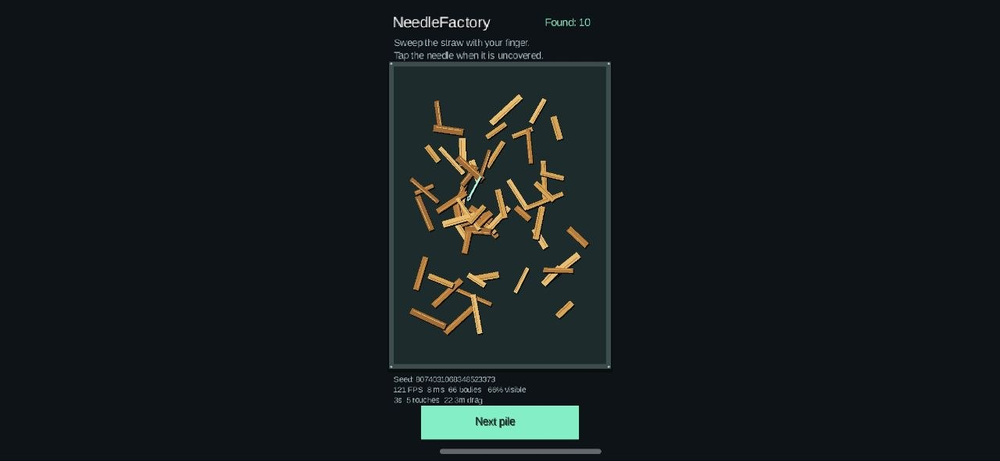
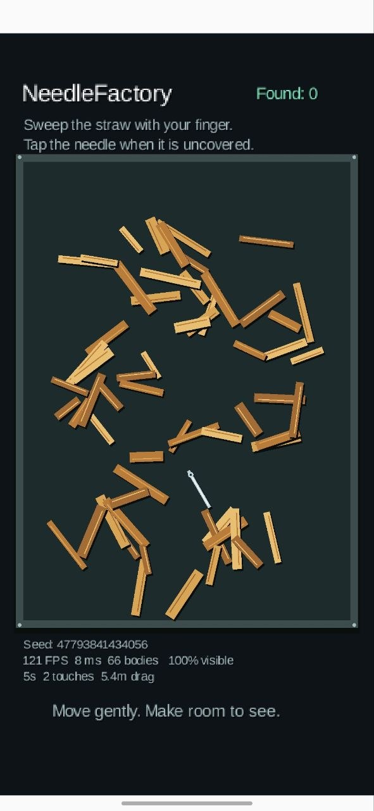

# 003 — Портретная ориентация в альбомной рамке / Portrait Mode in a Landscape Frame

## Русский

*3 октября 2026 года, 23:38.*

*Или как заставить игру выглядеть вертикальной, не сделав её вертикальной.*

**Статус:** ранняя доработка игрового прототипа, эксперимент с ориентацией.

Я специалист по видеопроизводству с опытом более 25 лет, а не профессиональный программист. Поэтому в NeedleFactory я выступаю как вайбкодер, энтузиаст нейросетей и человек, который привык, что если что-то не помещается в кадр, это можно поправить на монтаже. С программированием, как выяснилось, не всегда так просто.

На этом этапе NeedleFactory уже стала больше похожа на игру: среди деревянных элементов соломы видна металлическая иголка, работает отображение счётчика находок, а на одном из снимков появилась кнопка **Next pile**.

### Два снимка — два состояния

1. **Вертикальный экран.** На поле видна иголка; счётчик **Found: 0**, отладочные показатели **121 FPS**, **8 ms**, **66 bodies**, **100% visible**, **2 touches**, **5.4 m drag**. Это значения конкретного кадра, а не итог тестирования.
2. **Альбомный экран.** Вертикальное игровое поле расположилось узкой колонкой посередине широкого экрана, оставив огромные пустые пространства по бокам. Счётчик показывает **Found: 10**, появилась кнопка **Next pile**; в отладке видны **121 FPS**, **8 ms**, **66 bodies**, **66% visible**, **5 touches**, **22.3 m drag**.

### Маленькое открытие

Я хотел, чтобы игра нормально работала в альбомной ориентации. Вместо этого вертикальная версия просто переехала в центр горизонтального экрана. По бокам осталось столько свободного места, что туда можно было бы поставить титры, список съёмочной группы и ещё пару рекламных интеграций.

Выглядело почти как дизайнерское решение. Но нет: **полноценная адаптация под альбомную ориентацию тогда не работала**.

**Вывод:** повернуть экран и адаптировать интерфейс — не одно и то же. Зато иголка уже была на месте. Для начала неплохо!

### Иллюстрации

<figure class="screenshot landscape"><figcaption>Повернул телефон — получил вертикальную игру с местом для титров по бокам. Found: 10, а адаптация ещё в поиске.</figcaption></figure>
<figure class="screenshot portrait"><figcaption>В вертикальном кадре иголка уже видна: 100% visible, но Found: 0. В кадр попала — в счётчик пока нет.</figcaption></figure>

---

## English

*October 3, 2026, 23:38.*

*Or how to make a game look portrait-oriented without actually making it work in landscape.*

**Status:** early gameplay iteration and orientation experiment.

I'm a video production professional with over 25 years of experience, not a professional programmer. On NeedleFactory, I'm a vibe coder, an AI enthusiast, and someone used to fixing things in the edit when they don't fit the frame. As it turns out, software doesn't always cooperate quite so easily.

By this point, NeedleFactory was starting to look like an actual game. A metallic needle was visible among the straw-like wooden pieces, a found counter was on screen, and one screenshot showed a **Next pile** button.

### Two screenshots, two states

1. **Portrait screen.** A needle is visible on the playfield. Debug values include **Found: 0**, **121 FPS**, **8 ms**, **66 bodies**, **100% visible**, **2 touches**, and **5.4 m drag**. These are single-frame observations, not benchmark results.
2. **Landscape screen.** The portrait playfield appears as a narrow column in the middle of a wide display, with enormous empty margins. The counter reads **Found: 10** and a **Next pile** button is visible. Debug values include **121 FPS**, **8 ms**, **66 bodies**, **66% visible**, **5 touches**, and **22.3 m drag**.

### A small discovery

I wanted the game to work properly in landscape. Instead, the portrait layout simply moved to the center of the horizontal screen. There was enough empty space on either side for end credits, the entire production crew, and a couple of sponsor messages.

It almost looked intentional. It wasn't: **proper landscape adaptation was not working yet**.

**Takeaway:** rotating a screen and adapting a layout are two very different things. At least the needle was already there. That's a start!

### Images

<figure class="screenshot landscape"><figcaption>I rotated the phone and got a portrait game with room for credits on both sides. Found: 10; the responsive layout was still missing.</figcaption></figure>
<figure class="screenshot portrait"><figcaption>The needle is visible in portrait: 100% visible, but Found: 0. It made it into the frame, but not the counter yet.</figcaption></figure>
