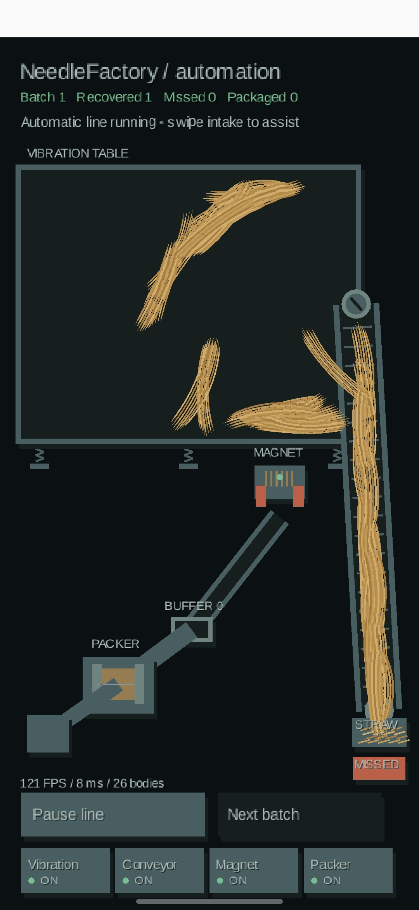

# 004 — Я хотел найти иголку. В итоге построил завод / I Wanted to Find a Needle. I Built a Factory Instead.

**4 октября 2026, 13:26 / October 4, 2026, 1:26 PM**  
**Статус / Status:** эксперимент с автоматизацией / automation experiment

## Русский

Сначала я собирался сделать простую игру: стог сена, спрятанная иголка, палец по экрану — ищем. Что может быть проще?

Но потом я подумал: а зачем всё время копаться в сене руками? Мы же живём в XXI веке. Надо механизировать процесс!

И вот вместо стога сена на экране появилась **целая производственная линия**. Вибростол, конвейер, магнит, буфер, упаковщик. Смотрю на результат и понимаю: то ли это схема завода, то ли картина художника-абстракциониста, который слишком увлёкся киберпанком.

Особенно меня радует солома. Она уже не похожа на деревянные палочки из предыдущих версий — теперь это длинные тонкие волокна, которые живут своей жизнью. Местами даже чересчур самостоятельной.

На скриншоте написано **NeedleFactory / automation**. Есть **Batch 1**, **Recovered 1**, **Missed 0**, **Packaged 0**. Работают четыре модуля — **Vibration**, **Conveyor**, **Magnet** и **Packer**, все отмечены как **ON**. Видны кнопки **Pause line** и **Next batch**. Снизу по-прежнему бодрые **121 FPS**, **8 ms**, **26 bodies**.

По крайней мере, какая-то механизация уже есть. А то, что конвейер пока напоминает лестницу в параллельную реальность, — это художественная особенность раннего прототипа. Будем считать, что так и задумано.

**Вывод дня:** хотел искать иголку в стоге сена, а теперь, кажется, придётся разбираться ещё и в промышленной логистике.

<figure class="screenshot portrait"><figcaption>Мой первый завод: одна иголка уже найдена, упаковка ещё впереди. Солома тем временем осваивает промышленную логистику.</figcaption></figure>

---

## English

At first, I was going to make a simple game: a haystack, a hidden needle, and a finger swiping across the screen. How hard could it be?

Then I thought: why keep digging through straw by hand? It's the 21st century. Let's mechanize the whole thing!

And just like that, my haystack became **an entire production line**. A vibration table, conveyor, magnet, buffer, and packer. Looking at the result, I honestly couldn't tell whether I'd built a factory or commissioned a cyberpunk abstract painting.

The straw is a particular achievement. It no longer looks like the wooden sticks from earlier versions. Now it's made of long, thin strands with a mind of their own. Sometimes a little too much of a mind.

The screen says **NeedleFactory / automation**. It shows **Batch 1**, **Recovered 1**, **Missed 0**, and **Packaged 0**. Four modules — **Vibration**, **Conveyor**, **Magnet**, and **Packer** — are marked **ON**. There are **Pause line** and **Next batch** buttons. And at the bottom: a cheerful **121 FPS**, **8 ms**, and **26 bodies**.

At least there's some actual mechanization now. As for the conveyor looking like a staircase into another dimension, let's call that an artistic feature of the early prototype.

**Today's takeaway:** I wanted to find a needle in a haystack. Somehow, I ended up needing to learn industrial logistics.

<figure class="screenshot portrait"><figcaption>My first factory: one needle recovered, packaging still ahead. Meanwhile, the straw is learning industrial logistics.</figcaption></figure>
