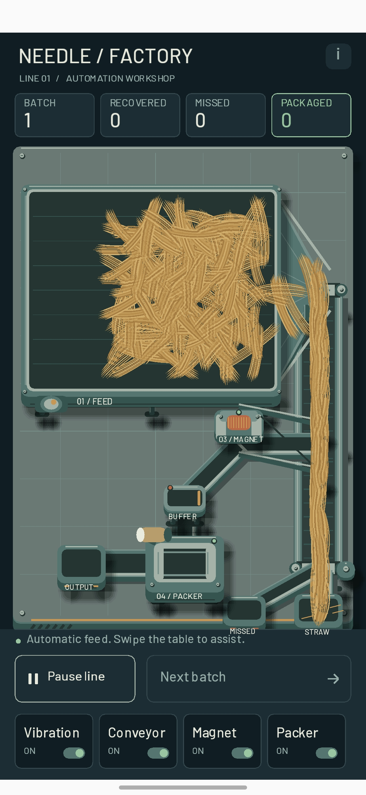
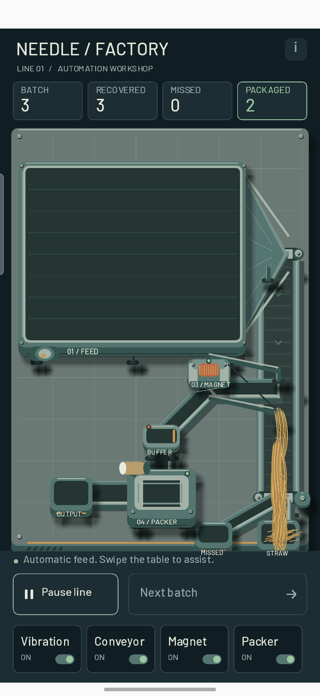

# 005 — Позвал ИИ в художественный отдел / I Called AI into the Art Department

## Русский

*4 октября 2026 года, 18:34.*

Всё-таки свой прошлый опыт абстракциониста и художника-неудачника я признаю неудачным. Завод вроде есть, но выглядит так, будто его рисовали по описанию человека, который видел конвейер один раз — и то во сне.

Решил призвать на помощь силы ИИ. Попросил помочь изобразить что-нибудь получше: чтобы вибростол был похож на вибростол, магнит — на магнит, а вся конструкция — на небольшую производственную мастерскую.

Ну что ж, вышло сносно. У машин появились корпуса, опоры и тени, интерфейс стал аккуратнее, а завод наконец перестал выглядеть как спор геометрических фигур. Солома, правда, всё ещё живёт своей жизнью. Видимо, в художественный отдел она не записывалась.

Пока приму это за начальную графику и буду придерживаться этого направления. До идеала ещё далеко, но теперь хотя бы есть от чего отталкиваться. Художника во мне временно отправляю в отпуск — пусть не мешает производству.

### Скриншоты

<figure class="screenshot portrait"><figcaption>Мастерская с новой графикой. Теперь хотя бы понятно, что я строю завод, а не выставку современного искусства.</figcaption></figure>
<figure class="screenshot portrait"><figcaption>Та же мастерская в работе: три иголки найдены, две упакованы. Художественный отдел пока может выдохнуть.</figcaption></figure>

---

## English

*October 4, 2026, 18:34.*

I have to admit that my previous attempt as an abstract artist and unsuccessful painter was, well, unsuccessful. There was a factory, but it looked as though it had been drawn from a description by someone who had seen a conveyor once — in a dream.

So I called in the powers of AI. I asked for help making something better: a vibration table that looked like a vibration table, a magnet that looked like a magnet, and a whole setup that resembled a small production workshop.

Well, it turned out reasonably well. The machines gained proper housings, supports, and shadows. The interface became tidier, and the factory finally stopped looking like an argument between geometric shapes. The straw still has a mind of its own, though. Apparently, it never joined the art department.

For now, I'll accept this as the starting graphics and stick with this direction. It's still a long way from perfect, but at least I have something to build on. The artist in me is taking a temporary holiday — best not to interfere with production.

### Screenshots

<figure class="screenshot portrait"><figcaption>The workshop with its new graphics. At least it's clear I'm building a factory rather than a contemporary art exhibition.</figcaption></figure>
<figure class="screenshot portrait"><figcaption>The same workshop in action: three needles recovered, two packaged. The art department can breathe for now.</figcaption></figure>

