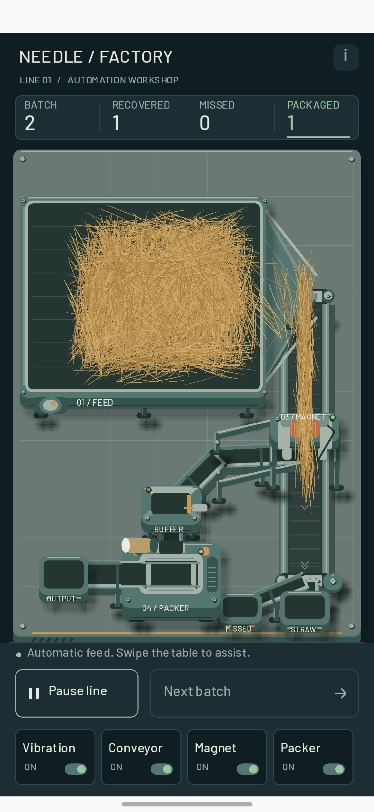
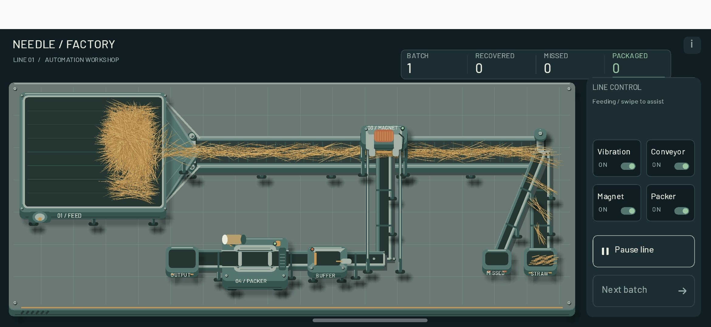

# 006 — Солома, пучки и горизонтальные сомнения / Straw, Bundles, and Landscape Doubts

## Русский

*4 октября 2026 года, 19:05.*

В прошлой версии солома была какой-то ватой, что ли. Завод уже выглядел приличнее, а материал на конвейере всё ещё напоминал содержимое подушки. Решил, что пора вернуть соломе её профессиональную идентичность.

Переделал соломинки. Теперь пучок можно описать так: несколько соломинок, соединённых ближе к середине под разными случайными острыми углами. Звучит как инструкция по сборке крайне неудобной метлы, но именно такой беспорядок мне и был нужен. Отдельные соломинки вместо причёсанных прядей.

А ещё я таки сделал горизонтальный режим. На этот раз завод действительно разложился по широкому экрану, а не просто встал узкой колонкой посередине. Технически — маленькая победа. Но мне не понравилось. Оказывается, «я смог это сделать» и «мне нравится результат» — две разные галочки.

### Скриншоты

<figure class="screenshot portrait"><figcaption>Новая солома в вертикальном режиме. Вместо ватных прядей — пучки отдельных соломинок. Парикмахерскую на заводе закрываем.</figcaption></figure>
<figure class="screenshot landscape"><figcaption>Горизонтальный режим наконец появился. Сделать получилось; полюбить результат — пока нет.</figcaption></figure>

---

## English

*October 4, 2026, 19:05.*

In the previous version, the straw looked like cotton wool, or something along those lines. The factory was looking better, but the material on the conveyor still resembled the contents of a pillow. Time to give the straw its professional identity back.

I reworked the stems. Here's how I'd describe a bundle now: several straw stems joined near their centers at different random acute angles. It sounds like instructions for assembling a deeply impractical broom, but that was exactly the kind of disorder I wanted. Individual stems instead of neatly combed strands.

And I finally made landscape mode. This time, the factory actually spread out across the wide screen instead of standing in a narrow column in the middle. Technically, a small victory. But I didn't like it. Apparently, “I managed to make it” and “I like the result” are two different boxes to tick.

### Screenshots

<figure class="screenshot portrait"><figcaption>New straw in portrait mode. Individual stems bundled together instead of cotton-like strands. The factory hair salon is closing.</figcaption></figure>
<figure class="screenshot landscape"><figcaption>Landscape mode finally arrived. I managed to make it; liking the result is another matter.</figcaption></figure>
