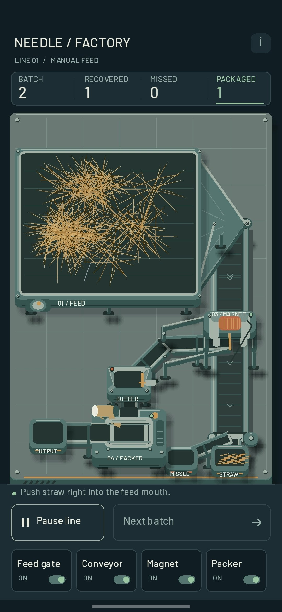
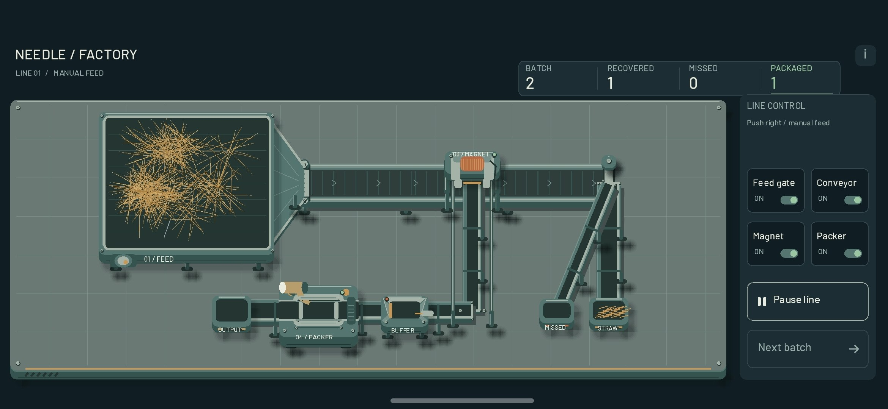

# 007 — Хотел солому. Получил волосатые шарики / I Wanted Straw. I Got Hairballs

## Русский

*4 октября 2026 года, 23:15.*

Что-то опять не то. В прошлый раз я избавлялся от соломы, похожей на вату. Теперь попробовал сделать её по-другому — и получил какие-то волосатые шарики. Видимо, моя сельскохозяйственная продукция решила пройти эволюцию и обзавестись собственной причёской.

Хотелось естественных, неровных пучков. Получились колючие комочки, подозрительно похожие на маленьких ёжиков после тяжёлого рабочего дня. Завод у меня уже есть. Теперь, судя по всему, ещё и питомник.

Сижу, пытаюсь сформулировать, чем солома отличается от волосатого шарика. В жизни разница очевидна. Когда нужно объяснить её так, чтобы на экране появилось именно то, что я задумал, — внезапно начинаются философия, геометрия и тихие переговоры с собственным терпением.

Самое смешное: я взялся строить целую производственную линию, а мучаюсь из-за нескольких соломинок. Магнит, конвейер, упаковщик — всё серьёзно. Но главный босс этой игры пока не экономика и не физика. Главный босс — сделать так, чтобы сено наконец выглядело как сено.

### Скриншоты

<figure class="screenshot portrait"><figcaption>Хотел естественные пучки соломы. Получился питомник маленьких волосатых шариков.</figcaption></figure>
<figure class="screenshot landscape"><figcaption>Повернул телефон — шарики остались шариками. Сменой ракурса этот художественный кризис не лечится.</figcaption></figure>

---

## English

*October 4, 2026, 23:15.*

Something is wrong again. Last time, I was trying to get rid of straw that looked like cotton wool. Now I tried making it differently — and ended up with little hairballs. Apparently, my agricultural produce decided to evolve and grow a hairstyle of its own.

I wanted natural, uneven bundles. I got spiky little clumps suspiciously resembling hedgehogs after a hard day's work. I already have a factory. Now, apparently, I also have a nursery.

Here I am, trying to put into words what makes straw different from a hairball. In real life, the distinction is obvious. When I have to explain it so that the screen shows exactly what I imagined, suddenly it becomes philosophy, geometry, and quiet negotiations with my remaining patience.

The funniest part: I set out to build an entire production line, yet a few pieces of straw are giving me grief. Magnet, conveyor, packer — serious business. But the game's main boss isn't economics or physics yet. The main boss is making hay finally look like hay.

### Screenshots

<figure class="screenshot portrait"><figcaption>I wanted natural straw bundles. I got a nursery of little hairballs.</figcaption></figure>
<figure class="screenshot landscape"><figcaption>I rotated the phone — the balls remained balls. A different camera angle cannot cure this artistic crisis.</figcaption></figure>
