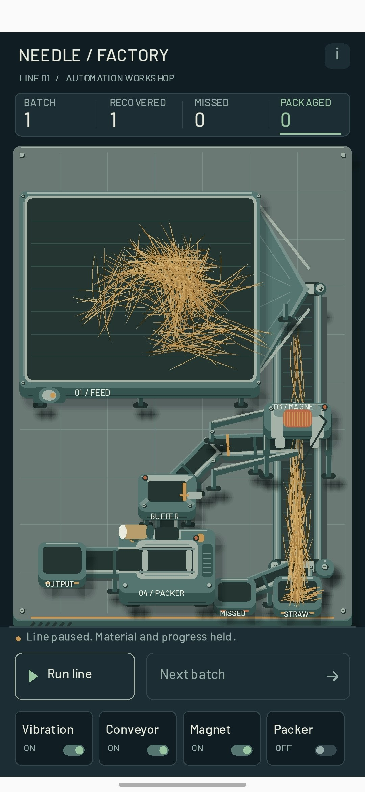

# 008 — Работает, падла! Теперь есть видео / It Works, Damn It! And There's Video

## Русский

*5 октября 2026 года, 03:07.*

После ваты и волосатых шариков сделал нечто среднее арифметическое. Солома всё ещё не претендует на обложку сельскохозяйственного журнала, но хотя бы перестала каждый раз открывать новый биологический вид.

А главное — наконец не забыл записать видео для бложика. Теперь можно не только смотреть на завод, но и увидеть его в работе. Работает, падла! В три часа ночи это уже вполне достаточный повод для маленького праздника.

Правда, перемещение соломы получилось немного не таким, как я представлял. Я её не цепляю и не тащу за пальцем: она толкается перед точкой касания. Получился палец-бульдозер. Для разгребания сена, возможно, вполне подходящая профессия.

Пока думаю: нормально так оставить или всё-таки переделать? Работает — аргумент весомый. Но хочется ещё понять, насколько удобно этим пользоваться.

### Фото и видео

<figure class="screenshot portrait"><figcaption>Мой компромисс между ватой и волосатыми шариками. Остановил линию для фото — солома пока никуда не убежала.</figcaption></figure>
<figure class="screenshot video"><video controls playsinline preload="none" width="1280" height="590" poster="../assets/screenshots/008-video-poster.jpg" aria-label="Работа линии NeedleFactory и перемещение соломы касанием"><source src="../assets/videos/008-line-demo.mp4" type="video/mp4">
<a href="../assets/videos/008-line-demo.mp4">Открыть видео</a>
</video><figcaption>Наконец не только скриншоты: записал, как всё это работает. Видно и солому, и мой способ её толкать. <a href="../assets/videos/008-line-demo.mp4" download>Скачать видео</a></figcaption></figure>

---

## English

*October 5, 2026, 03:07.*

After cotton wool and hairballs, I made something like the arithmetic mean of the two. The straw still isn't ready for the cover of a farming magazine, but at least it has stopped discovering a new biological species with every revision.

More importantly, I finally remembered to record a video for the blog. Now you can see the factory in action instead of just looking at a screenshot. It works, damn it! At three in the morning, that's a perfectly good reason for a small celebration.

The straw movement isn't quite what I imagined, though. I don't grab it and drag it behind my finger: it gets pushed ahead of the touch point. I've made a bulldozer finger. For clearing hay, that might actually be a reasonable occupation.

I'm still thinking: is this fine as it is, or should I rework it? “It works” is a strong argument. But I also want to find out how comfortable it is to use.

### Photo and video

<figure class="screenshot portrait"><figcaption>My compromise between cotton wool and hairballs. I paused the line for a photo — the straw has not escaped yet.</figcaption></figure>
<figure class="screenshot video"><video controls playsinline preload="none" width="1280" height="590" poster="../assets/screenshots/008-video-poster.jpg" aria-label="NeedleFactory line in operation and straw movement through touch"><source src="../assets/videos/008-line-demo.mp4" type="video/mp4">
<a href="../assets/videos/008-line-demo.mp4">Open video</a>
</video><figcaption>Finally, more than screenshots: I recorded the whole thing in action, including the straw and how I push it. <a href="../assets/videos/008-line-demo.mp4" download>Download video</a></figcaption></figure>
